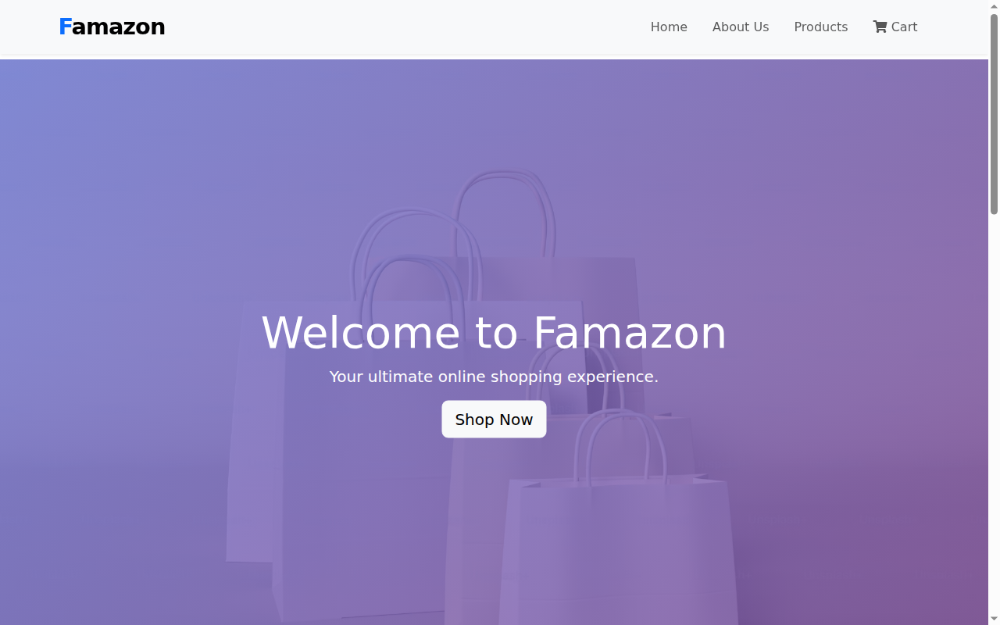
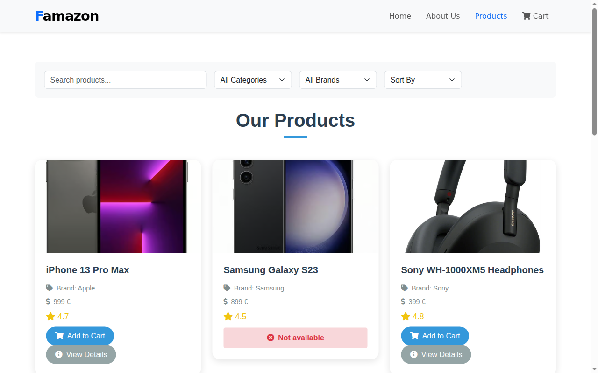
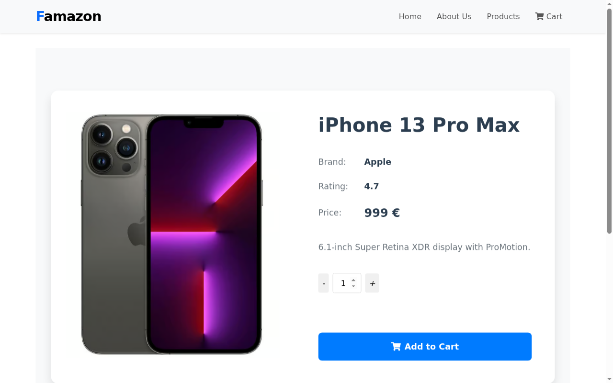
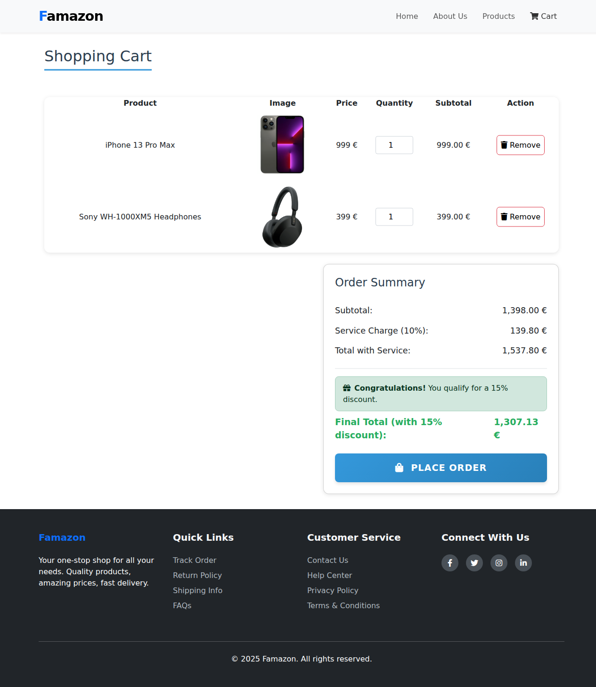

# Famazon – Angular E-Commerce Storefront

A responsive online electronics store built with **Angular 19** and **Bootstrap 5**: browse a product catalog, search and filter it, view product details, and manage a shopping cart with live order totals and automatic discounts.

<!-- Live demo: add your deployed URL here, e.g. https://<username>.github.io/E-Commerce-Project/ -->

| Home | Product catalog |
| --- | --- |
|  |  |
| **Product details** | **Shopping cart** |
|  |  |

## Key features

- **Product catalog** – product cards with image, brand, price, rating and stock status; out-of-stock items are clearly marked and can't be added to the cart.
- **Search, filter & sort** – live text search across names and descriptions, filters by category and brand, and sorting by price (low/high), rating or name.
- **Product details page** – dedicated page per product (`/details/:id`) with full description and a quantity selector.
- **Shopping cart** – add items from the catalog or details page, change quantities, remove items, and get instant feedback via "added to cart" alerts.
- **Live order summary** – subtotal, 10% service charge and total update instantly; a 15% discount is applied automatically when the order qualifies.
- **Multi-page navigation** – Home, About, Products and Cart pages with client-side routing and a wildcard fallback route.
- **Responsive design** – mobile-friendly layout with a collapsible navbar, built on the Bootstrap grid.

## Tech stack


- **Frontend:** Angular 19 (components, Angular Router, template-driven forms with `ngModel`), TypeScript, RxJS
- **Styling/UI:** Bootstrap 5.3, custom CSS, Font Awesome icons
- **State:** Angular service (`CartService`) injected across components as a single source of truth for the cart
- **Data:** local, typed product catalog (no backend required)
- **Tooling:** Angular CLI, Git & GitHub

## My role & contributions

This was an individual project (FE24 exam project) – I designed and built the whole application:

- Planned the page structure and implemented the Angular components: `navbar`, `hero`, `home`, `about`, `product-list`, `product-details`, `cart` and `footer`.
- Set up client-side routing, including a parameterised product details route (`details/:id`) that reads the product id via `ActivatedRoute`.
- Built a reusable `CartService` that handles adding/removing items, quantity updates and all price calculations, shared between the catalog, details and cart pages.
- Implemented the search, category/brand filtering and sorting logic for the catalog.
- Designed a responsive UI with Bootstrap and custom styling (gradient hero sections, product cards, order summary).

## Challenges & solutions

- **Sharing cart state between pages** – Instead of passing data through component inputs, I centralised the cart in a root-provided Angular service. Every page reads from and writes to the same instance, so the catalog, details page and cart always stay in sync.
- **Combining search, filters and sorting** – All criteria (search term, category, brand, price range) are applied in a single `applyFilters()` pass, followed by the selected sort. This keeps the logic in one place and makes it easy to add new filters.
- **Accurate order totals** – Subtotal, service charge and discount are computed in the service rather than in templates, keeping the components simple and the business rules in one testable place. Prices are formatted consistently with Angular's `number` pipe.

## Run locally

This repository contains the **production build** of the app (the compiled output of `ng build`), so no install step is needed – it just has to be served by a static web server.

```bash
# 1. Clone the repository
git clone https://github.com/djudiasaad/E-Commerce-Project.git
cd E-Commerce-Project

# 2. Serve the folder (pick one)
npx serve -s .            # Node.js – "-s" enables SPA fallback for Angular routes
# or
python3 -m http.server 4200
```

Then open the URL printed in the terminal (e.g. `http://localhost:3000` or `http://localhost:4200`).

> **Note:** The app uses `<base href="/">`, so serve it from the web server root. With a server that has no SPA fallback (like `python -m http.server`), start at the home page and navigate from there – refreshing on a sub-route such as `/products` will return a 404.

## Project structure

```
E-Commerce-Project/
├── index.html              # App entry point (<app-root>)
├── main-*.js               # Compiled Angular application (components, routing, services)
├── polyfills-*.js          # Angular polyfills
├── scripts-*.js            # Bootstrap JS bundle
├── styles-*.css            # Bootstrap + custom styles
├── favicon.svg
├── img/                    # Product images
└── docs/screenshots/       # README screenshots
```

Application routes:

| Route          | Page                                  |
| -------------- | ------------------------------------- |
| `/`            | Home (hero, highlights, reviews)      |
| `/products`    | Product catalog with search & filters |
| `/details/:id` | Product details                       |
| `/cart`        | Shopping cart & order summary         |
| `/about`       | About the store                       |

## Future improvements

- Persist the cart in `localStorage` so it survives page reloads.
- Connect to a REST API and database instead of a local product list.
- Add user authentication and an order history page.
- Add a price-range slider to the catalog filters.
- Add unit tests (Jasmine/Karma) for the cart calculations and filtering logic.
- Deploy a live demo (GitHub Pages / Netlify).

## License

This project is licensed under the [MIT License](LICENSE).
